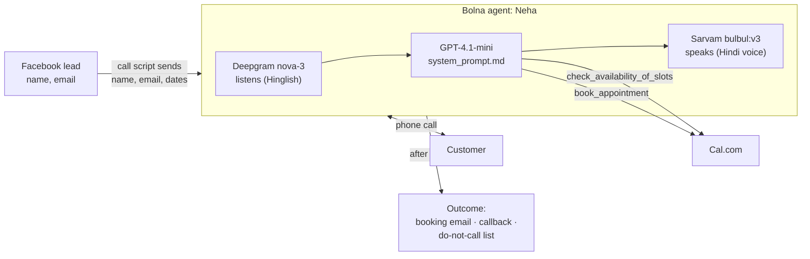

# Mahima Palm Springs: Outbound Hinglish Voice AI Agent

**Neha** is an outbound voice AI agent for **Mahima Palm Springs**, a premium gated township on Tonk Road, Jaipur. She calls people who enquired through a Facebook ad, talks in natural Hinglish, checks it is a good time to talk, shares only verified project facts, and **books a real site visit** on a Cal.com calendar.

Built by Aarit Mehta for the Futwork Prompt Engineer assignment.

## Start here

| What | Where |
|---|---|
| **Project and test report** (what I built, tools, tests, live calls) | [PROJECT_AND_TEST_REPORT.md](PROJECT_AND_TEST_REPORT.md) |
| **The prompt used** (v1.0) | [prompts/system_prompt.md](prompts/system_prompt.md) |
| **Test cases** (49) | [tests/test_cases.csv](tests/test_cases.csv) |
| **Test results** (every live call, every defect and fix) | [tests/test_results.md](tests/test_results.md) |
| **Main call recording** | [Listen on Google Drive](https://drive.google.com/file/d/14V9dwW7G8zMHNY7-hMzpAcy6izRNqF48/view?usp=sharing) · [transcript](evidence/transcript.md) |
| **Design choices and learnings** | [DESIGN_AND_LEARNINGS.md](DESIGN_AND_LEARNINGS.md) |

## Results

| | |
|---|---|
| Final prompt | **v1.0**: 9 sections in the brief's format, 56 Hinglish dialogues, each followed by Instructions |
| Live tests on v1.0 | **5 of 5 passed**: site visit booking, guardrails, senior expert request, busy callback, opt-out |
| Main call | Real availability checked, a taken slot handled, booking **Confirmed in Cal.com** |
| Iteration | 11 prompt versions (v0.1 to v1.0), 20 defects found in testing and fixed, each logged in the [change log](prompts/prompt_change_log.md) |

## How it works



**The call, in the brief's order:** Greeting → Introduction with a good-time check → Main Pitch → Site Visit Booking → Conclusion. AI Agent Background, Global Rules, Guardrails and FAQs sit around the script.

**Key rules in the prompt**
- Only the five facts from the brief are ever stated. Anything else gets: "इसकी verified जानकारी अभी मेरे पास नहीं है" plus an offer to check with the sales team.
- No total price is ever calculated.
- A visit is called "booked" only after the calendar confirms it.
- Short replies, one question at a time, numbers in words, every time said with सुबह, दोपहर or शाम.
- Honest about being an AI; "not interested" and "don't call me" are always respected.

**After the call**
- A **busy customer's callback** ("kal shaam") becomes a real scheduled call.
- An **opt-out** puts the number on a do-not-call list, and any pending callbacks are cancelled.
- A **senior expert** request is logged for the sales team.

## Repository

```
prompts/         the prompt (v1.0), call-flow design, change log
tests/           test cases, results, rubric, real call transcripts, automatic checker
evidence/        main call transcript and recording links
configuration/   Bolna, Cal.com and post-call extraction setup
knowledge/       the verified project facts
scripts/         place a call, act on the outcome after a call, cancel a scheduled call
```

## Limitations

- The calendar is a **demonstration** Cal.com calendar, not Mahima Palm Springs' real site schedule.
- Only the facts given in the brief are verified; amenities, RERA, charges and payment plans are deliberately escalated.
- All test calls were made to my own number. A real campaign in India would also need DLT-registered calling numbers.

No API keys, phone numbers or personal emails are stored in this repository.

## Credits

Reference repositories were studied for ideas only. No application code from them is used.

| Source | Licence | Used for |
|---|---|---|
| [bolna-ai/skills](https://github.com/bolna-ai/skills) | MIT | Bolna prompt structure, the Cal.com tool flow and configuration guidance |
| [navonilmandal/real_estate_ai_agent](https://github.com/navonilmandal/real_estate_ai_agent) | MIT | Ideas for objection handling, anti-hallucination behaviour and test categories; none of its property facts are used |
| [DINAKAR-S/voice-agent-starter-kit](https://github.com/DINAKAR-S/voice-agent-starter-kit) | MIT | Hindi voice style ideas: always "aap", short turns, domain words in English |
| [KashishRaheja001/estateflow](https://github.com/KashishRaheja001/estateflow) | No licence file | Read to understand the Bolna outbound-call lifecycle; nothing copied |
