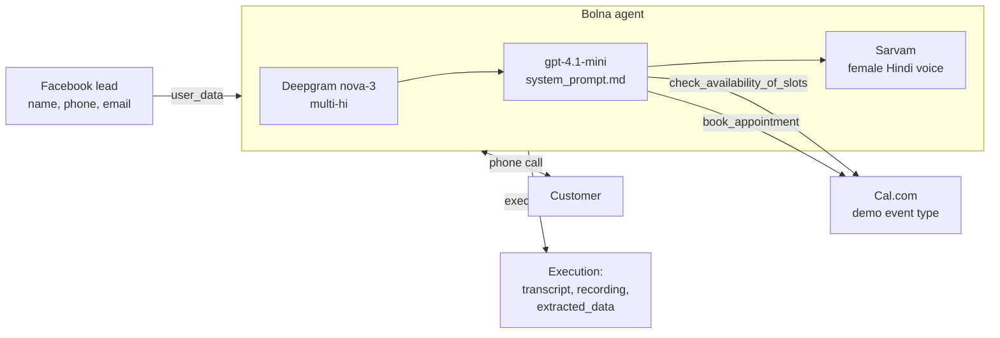

# Mahima Palm Springs: Outbound Hinglish Voice AI Agent

An outbound voice AI sales agent, **Neha**, who calls people who enquired about **Mahima Palm Springs** (Tonk Road, Jaipur) through a Facebook ad. She talks in natural Hinglish, checks it is a good time, pitches only verified facts, handles objections, and books a **real site visit** through Cal.com availability and booking tools.

Built on **Bolna** with no custom code. This repository is the submission package: the prompt, the design, the test plan and the evidence.

## Quick links

| What | Where |
|---|---|
| **Design choices, prompt style and learnings** | [DESIGN_AND_LEARNINGS.md](DESIGN_AND_LEARNINGS.md) |
| **The prompt used** | [prompts/system_prompt.md](prompts/system_prompt.md) |
| How a lead triggers a call (API + `user_data`, do-not-call check) | [scripts/place_call.ps1](scripts/place_call.ps1) |
| After the call: opt-out → do-not-call list, callback → scheduled call | [scripts/post_call.ps1](scripts/post_call.ps1) |
| Automatic transcript checker + 5 real call transcripts | [tests/check_transcript.py](tests/check_transcript.py) · [tests/transcripts/](tests/transcripts/) · [report](tests/transcript_check_report.md) |
| Call flow, state model, Roman reading copy | [prompts/conversation_flow.md](prompts/conversation_flow.md) |
| Test cases (49; core T01–T15) | [tests/test_cases.csv](tests/test_cases.csv) |
| Evaluation rubric | [tests/evaluation_rubric.md](tests/evaluation_rubric.md) |
| Test results | [tests/test_results.md](tests/test_results.md) |
| Call recording | [evidence/recording_url.md](evidence/recording_url.md) |
| Transcript | [evidence/transcript.md](evidence/transcript.md) |
| Loom walkthrough | [evidence/loom_url.md](evidence/loom_url.md) |
| Requirements checklist | [assignment/requirements.md](assignment/requirements.md) |
| Submission checklist | [SUBMISSION_CHECKLIST.md](SUBMISSION_CHECKLIST.md) |

## Architecture



**Call lifecycle:**
1. The call is placed (`POST /call` or the dashboard).
2. Bolna returns an `execution_id`.
3. The conversation runs, with live Cal.com tool calls.
4. Post-call extractions fill `extracted_data`.
5. The transcript, recording URL and costs are read with `GET /executions/{id}`.

Webhooks can push the same payload in real time. They aren't needed for this demo, so no server is deployed.

## Closing the loop: the agent's words have consequences

| Customer says | During the call | After the call |
|---|---|---|
| "Haan, Saturday ko" | Real availability → one read-back (date, time with part of day, email) → booking | A Cal.com booking + confirmation email |
| "Kal shaam call karna" | "Main aapko kal shaam phir se call karoongi" | `post_call.ps1` schedules a real call for tomorrow 17:00 IST; it opens with "Aapne kaha tha ki main aapko is time par dobara call karoon" |
| "Mujhe call mat karna" | Immediate acknowledgement, no persuasion | The number goes on a do-not-call list; `place_call.ps1` **refuses** to dial it again |

## Key design choices

| Choice | Reason |
|---|---|
| Strict section structure: Background, Global Rules, Greeting, Introduction, Pitch, Booking, Conclusion, Guardrails, FAQs | Follows the assignment format and is easy to audit |
| Every `Agent:` line followed by `Instructions:` | Assignment requirement; the instructions hold the routing logic |
| Hinglish dialogue in Devanagari, with English words like flat, price and site visit kept in English | Better Sarvam TTS pronunciation than Roman Hindi |
| Facts whitelist | Only the five facts from the brief are spoken; everything else goes to a senior expert callback |
| No total price calculation | Area basis and extra charges are unknown, so any total would mislead |
| Three visit states: `not_requested`, `pending_confirmation`, `confirmed` | The agent can say "booked" only after the booking tool succeeds; a false confirmation is a critical failure |
| One light qualification question (3 BHK or 4 BHK), then pitch facts as a menu | Answers questions immediately instead of forcing a questionnaire |
| One standard line for unknowns: "इसकी verified जानकारी अभी मेरे पास नहीं है..." | Honest, consistent deferral to the sales team |
| Slots come only from the calendar tool, up to three, then read back before booking | No invented times and no accidental bookings |
| Name and email preloaded from the lead form and confirmed | Avoids spelling an email by voice, the most common failure |
| Neha says she is an AI assistant in the introduction | Honest, and avoids a trust break later |
| One soft probe on "not interested"; close after two declines; immediate opt-out | Persuasive but respectful |

Full reasoning: [prompts/conversation_flow.md](prompts/conversation_flow.md) and [prompts/prompt_change_log.md](prompts/prompt_change_log.md).

## Repository map

```
assignment/      requirements and deliverable map
knowledge/       the only verified property facts
prompts/         system prompt, flow design, change log
tests/           test cases, rubric, results
configuration/   Bolna, Cal.com and post-call extraction setup
evidence/        recording, transcript, Loom, screenshots
scripts/         place_call.ps1: the lead → Bolna API call (user_data incl. upcoming_dates)
.agents/skills/  official Bolna skills used as build instructions in the IDE
```

## Reproduce the agent

1. Set up Cal.com: [configuration/booking_setup.md](configuration/booking_setup.md).
2. Create the Bolna agent and paste the prompt: [configuration/bolna_setup.md](configuration/bolna_setup.md).
3. Add post-call extractions: [configuration/post_call_extraction.md](configuration/post_call_extraction.md).
4. Test in four rounds to fit a $5 credit budget: static desk check (done), one voice-check call, one end-to-end booking call (the recording), then regression. See [tests/evaluation_rubric.md](tests/evaluation_rubric.md).

**Current results:** 5 live calls, $1.08 spent. The submission call (`6b56f180`, v0.8) scored **98 of 100** with a **real, confirmed Cal.com booking**. 19 defects were found across static checks, live calls and the automatic transcript checker, and fixed through prompt versions v0.2 to v1.0. Each one is traced in [tests/test_results.md](tests/test_results.md) and [prompts/prompt_change_log.md](prompts/prompt_change_log.md). v1.0 live re-tests are in progress.

No API keys, phone numbers or personal emails are stored in this repository.

## Limitations

- **Demo calendar.** The Cal.com availability is a demonstration schedule, not the real site office's timings.
- **Facts.** Only the facts given in the brief are verified. Amenities, RERA, charges and payment plans are deliberately escalated.
- **Callbacks.** The "senior expert will call tomorrow 10 AM to 5 PM" line comes from the assessment's example script. The request is recorded as an extraction field only; no CRM or scheduler acts on it.
- **Indian telecom compliance.** Real commercial outbound campaigns in India need DLT-registered numbers (140-series for promotional calls). The demo only calls the developer's own phone.

## Credits and licences

Reference repositories were studied for patterns only. No application code from them is used.

| Source | Licence | Used for |
|---|---|---|
| [bolna-ai/skills](https://github.com/bolna-ai/skills) | MIT | Prompt structure; the two static prompt modules (*Conversational Naturalization*, *Pronunciation and Script Normalisation*), adapted; Cal.com tool flow; configuration guidance. Skill files are included in `.agents/skills/` under their MIT licence |
| [navonilmandal/real_estate_ai_agent](https://github.com/navonilmandal/real_estate_ai_agent) | MIT | Ideas for objection handling, anti-hallucination behaviour and test categories. None of its fictional property facts are used |
| [DINAKAR-S/voice-agent-starter-kit](https://github.com/DINAKAR-S/voice-agent-starter-kit) | MIT | Hindi voice style ideas: always "aap", short turns, domain words in English |
| [KashishRaheja001/estateflow](https://github.com/KashishRaheja001/estateflow) | No licence file | Read for an understanding of the Bolna outbound-call and webhook lifecycle only. Nothing is copied |
